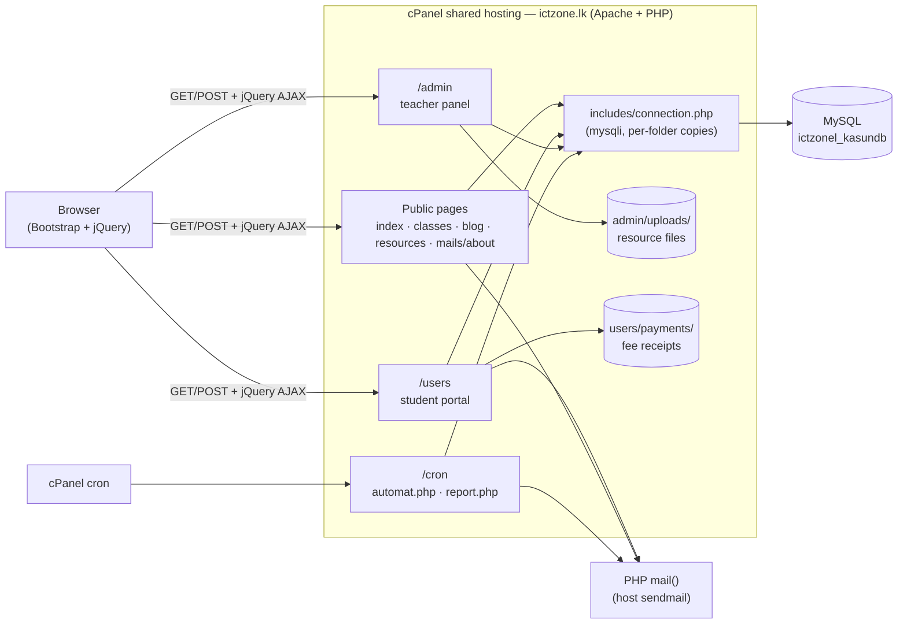
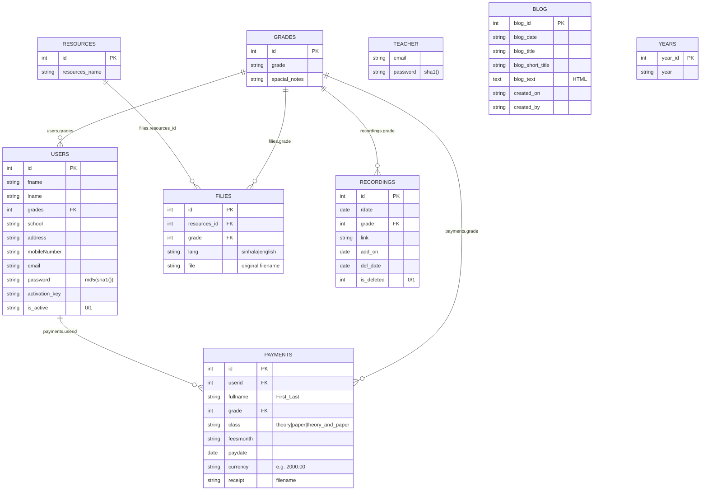
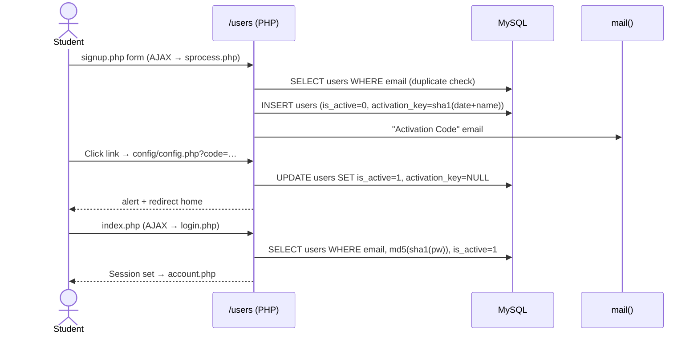

# ICT ZONE 


## Table of Contents

1. [What the System Is](#1-what-the-system-is)
2. [Architecture](#2-architecture)
3. [Tech Stack](#3-tech-stack)
4. [Folder Structure](#4-folder-structure)
5. [User Roles & Authentication](#5-user-roles--authentication)
6. [Feature Catalogue](#6-feature-catalogue)
7. [Page / Script Reference](#7-page--script-reference)
8. [Database](#8-database)
9. [Emails](#9-emails)
10. [Cron Jobs](#10-cron-jobs)
11. [End-to-End Flows](#11-end-to-end-flows)
12. [Deployment & Configuration](#12-deployment--configuration)

---

## 1. What the System Is

The personal website of ICT teacher **Kasun Fernando** (B.Sc., PGDE Colombo; Science Kingdom Higher Educational Institute; *Guru Gedara* TV programme presenter). It serves Grade 9, O/L and A/L ICT students and has four parts:

| Area | Purpose |
|---|---|
| **Public website** | Home, class timetable, blog, downloadable resources (past papers etc.), About Us + contact form |
| **Student portal** (`/users`) | Sign up with email activation, log in, watch class recordings for own grade, upload monthly fee receipts, view/edit profile, reset password |
| **Admin panel** (`/admin`) | Teacher login, upload resources, add/edit/delete recordings, create/edit/delete blog posts, view students, view payments, "Paid vs All" fee overview |
| **Cron jobs** (`/cron`) | Daily expiry of recordings, monthly payment report emailed to the teacher |

---

## 2. Architecture

A classic **server-rendered PHP** site with no framework, router or MVC. Each `.php` file is a page or an AJAX endpoint that talks to MySQL directly with `mysqli`.



- **Sessions:** native PHP sessions (`$_SESSION`). Students and the admin share the same session namespace.
- **AJAX:** most forms post via jQuery `$.ajax` / `jquery.form` (`ajaxForm`), and the PHP script echoes an HTML alert snippet back.
- **Email:** PHP's built-in `mail()` with inline HTML templates (Stripo-style responsive emails).

---

## 3. Tech Stack

| Layer | Technology |
|---|---|
| Language | PHP (5.x/7.x era, procedural) |
| Database | MySQL via `mysqli` (no PDO, no prepared statements) |
| Web server | Apache (`.htaccess` for HTTPS/non-www redirects, `Options -Indexes`) |
| Hosting | cPanel shared hosting (`/home/ictzonel/public_html`) |
| UI | Bootstrap 5 (CSS/JS), custom `main.css` / `style.css`, Font Awesome 5 (self-hosted `icons/`), Bootstrap Icons (CDN) |
| JS | jQuery, `jquery.form.js` (AJAX file upload), jQuery lazyload, Tilt.js (login page), Select2, Animate.css, CSS-Hamburgers (admin `vendor/`) |
| Rich text | **CKEditor 4** (bundled in `admin/ckeditor`) for blog posts |
| Email | PHP `mail()` |
| Scheduling | cPanel cron hitting `cron/*.php` |
| SEO / analytics | `sitemap.xml`, meta/OG tags, Google Search Console verification, gtag.js (placeholder `GA_MEASUREMENT_ID`) |

---

## 4. Folder Structure

```
ictzone/
├── .htaccess                 # force https://ictzone.lk, disable directory listing
├── index.php                 # Home (hero + teacher profile)
├── classes.php               # Static class timetable + "Our Memories" gallery
├── blog.php                  # Blog viewer (?blog_id=) + latest-10 sidebar
├── resources.php             # Resource search form (category / grade / language)
├── file.php                  # Resource search results table
├── download.php              # Streams a file from admin/uploads/
├── sitemap.xml
├── includes/                 # Public-site shared parts
│   ├── connection.php        # DB connection
│   ├── function.php          # rescources(), grade(), blogs() dropdown/list helpers
│   ├── nav.php               # Top navbar + page loader
│   └── footer.php            # Contact, site map, latest blogs, social links
├── mails/                    # About Us + contact form
│   ├── about.php             # About page with contact form
│   ├── mail.js               # AJAX submit → mail.php
│   ├── mail.php              # Sends contact message via mail()
│   └── includes/             # copies of connection/nav/footer
├── users/                    # Student portal
│   ├── index.php             # Student login page
│   ├── login.php             # Login handler (AJAX)
│   ├── signup.php            # Signup page
│   ├── sprocess.php          # Signup handler + activation email
│   ├── config/
│   │   ├── config.php        # Account activation (?code=)
│   │   ├── passwordconfig.php# Password reset form + handler
│   │   └── passwordupdate.php# Debug stub (print_r($_POST))
│   ├── forget.php            # Forgot-password page (AJAX → veryfy.php)
│   ├── veryfy.php            # Sends password reset email
│   ├── account.php           # Student home (embedded YouTube lessons)
│   ├── recoding.php          # Class recordings for the student's grade
│   ├── profile.php           # Profile view + edit modal
│   ├── update.php            # Profile update handler (AJAX)
│   ├── paiment.php           # Fee receipt upload form
│   ├── upload.php            # Receipt upload handler + emails
│   ├── count.php             # Cookie + redirect helper (recording click tracking stub)
│   ├── logout.php
│   ├── function.js           # login(), signup(), user_update(), payment(), show/hide password
│   ├── includes/             # connection.php, function.php (grades, details, Sirsentmail), header.php (sidebar)
│   ├── payments/             # Uploaded receipts (PDF/JPG)
│   └── sql.sql               # Partial schema (recordings) + MySQL EVENT draft
├── admin/                    # Teacher panel
│   ├── index.php             # Admin login page
│   ├── login.php             # Admin login handler (table: teacher)
│   ├── logout.php
│   ├── admin.php             # Admin home: list of uploaded resource files
│   ├── includes/nav.php      # Admin sidebar/top nav
│   ├── functions/function.php# get_years(), recordings(), get_grades()
│   ├── input.php / upload.php# Resource upload form + handler
│   ├── add_recordings.php / record.php  # Add recording form + handler
│   ├── action.php            # Update / delete a recording (?id=&action=)
│   ├── blog-create.php       # New blog post (CKEditor)
│   ├── blog-table.php        # All blog posts
│   ├── blog-editor.php / blog-update.php / blog-delete.php
│   ├── students.php / data.php          # Students list + AJAX search
│   ├── paiment.php / searchpayment.php  # Payments list + AJAX search
│   ├── fees.php              # "Paid vs All": every active student + last payment
│   ├── uploads/              # Uploaded resource files
│   ├── ckeditor/             # CKEditor 4 bundle
│   └── css, js, fonts, images, vendor/
├── cron/
│   ├── automat.php           # Daily: soft-delete expired recordings
│   └── report.php            # Monthly: email payment report to teacher
├── css/, js/, img/, icons/   # Shared assets (Bootstrap, jQuery, Font Awesome)
└── error_log (×4)            # Production PHP error logs committed to the repo
```

---

## 5. User Roles & Authentication

| Role | Login page | Table | Password hashing | Session keys |
|---|---|---|---|---|
| **Student** | `/users/` → `users/login.php` | `users` | `md5(sha1(password))` | `id, fname, lname, grades, school, address, mobileNumber, email` |
| **Teacher / Admin** | `/admin/` → `admin/login.php` | `teacher` | `sha1(password)` | `email, password` (the hash) |

- A student can only log in when `is_active = '1'` (after email activation).
- Page protection is a check at the top of each page: `if (empty($_SESSION['id']))` for students and `if (empty($_SESSION))` for admin. A failed check **only prints a JavaScript redirect** (`redirect_two()`) and does not `exit`, so the rest of the page is still rendered (see §13).
- There is no admin registration. Teacher rows are inserted manually.

---

## 6. Feature Catalogue

### 6.1 Public Website

| Feature | Files | Details |
|---|---|---|
| **Home** | `index.php` | Hero "Information & Communication Technology", teacher profile (Kasun Fernando, B.Sc., PGDE, 10+ yrs experience) |
| **Navigation & loader** | `includes/nav.php` | Home · Class · Blog · Resources · About Us · Login. Active link via `$active` |
| **Footer** | `includes/footer.php` | Contact info, site map, **latest 5 blog posts** (`blogs()`), social links |
| **Class timetable** | `classes.php` | **Hard-coded HTML table**: Grade 9, 2021/2022 O/L Theory & Paper, 2021/2022/2023 A/L Theory & Paper, with days/times, all ONLINE. Plus a lazy-loaded "Our Memories" photo gallery |
| **Blog** | `blog.php` | Shows the selected post (`?blog_id=`) or the latest one: title, date, HTML body, creator, plus a sidebar with the latest 10 posts |
| **Resources** | `resources.php` → `file.php` → `download.php` | Choose a category (`resources` table), grade (`grades`) and language (Sinhala/English) to get a table of files, each downloaded via `download.php?file=` from `admin/uploads/` |
| **About Us** | `mails/about.php` | Teacher bio, Science Kingdom, Guru Gedara programme, class specialities (unique teaching, guaranteed target, high-quality colour tutes / videos / past papers), contact address/phone/email |
| **Contact form** | `mails/about.php`, `mail.js`, `mail.php` | Name, email and message are posted with AJAX and emailed to the site inbox |
| **SEO** | `sitemap.xml`, meta tags | 11 URLs in the sitemap, OG tags, canonical links, Search Console verification |

### 6.2 Student Portal (`/users`)

| Feature | Files | Details |
|---|---|---|
| **Sign up** | `signup.php`, `sprocess.php`, `function.js#signup` | First/last name, school, grade (dropdown from `grades` with special notes), email, address, mobile, password + confirm. Duplicate emails are rejected. The account is created inactive with an activation key, and an activation email is sent |
| **Account activation** | `config/config.php?code=` | Sets `is_active = 1` and clears the key, then redirects home with an alert |
| **Login** | `index.php`, `login.php`, `function.js#login` | AJAX login with show/hide password. Stores the profile in the session and redirects to `account.php` |
| **Dashboard** | `account.php`, `includes/header.php` | Sidebar (Home, Recordings, Your Profile, Payment Receipt, Logout) and **6 embedded YouTube lesson videos** |
| **Class recordings** | `recoding.php` | Table of recordings for the student's grade where `is_deleted = 0`: recorded date, expiry date, "Watch Recording" link |
| **Profile** | `profile.php`, `update.php`, `function.js#user_update` | View system ID, name, email, phone, school, grade, address. Edit name/school/email/address/mobile in a modal via AJAX |
| **Fee receipt upload** | `paiment.php`, `upload.php`, `function.js#payment` | Class (Theory / Paper / Both), month (Jan–Dec), payment date, amount, receipt file (**PDF/PNG/JPEG**). Saved as `users/payments/{First_Last}-{Month}_{class}_fees.{pdf\|jpg}`. One receipt per month per student. Emails the student a confirmation and the teacher an alert |
| **Forgot / reset password** | `forget.php`, `veryfy.php`, `config/passwordconfig.php` | Enter an email to receive a reset link (`?code=…&email=…`), then set a new password |
| **Logout** | `logout.php` | Destroys the session |
| **Recording click tracking** (stub) | `count.php` | Sets an `id` cookie and redirects to `?link=`. Not wired up |

### 6.3 Admin Panel (`/admin`)

Sidebar (`includes/nav.php`): **File Upload · Add Recordings · All Blogs · Blog Creator · Student Details · Paid vs All · Paid records · Logout**

| Feature | Files | Details |
|---|---|---|
| **Login / logout** | `index.php`, `login.php`, `logout.php` | AJAX login against the `teacher` table |
| **Home — uploaded files** | `admin.php` | Table of every resource file with category, grade, language |
| **Upload resources** | `input.php`, `upload.php` | Category, grade, language (Sinhala/English) and file, saved to `admin/uploads/` with the original filename and a row inserted into `filies` |
| **Add recordings** | `add_recordings.php`, `record.php` | Grade, recorded date, URL. `add_on = today`, `del_date = today + 14 days` |
| **List / update / delete recordings** | `functions/function.php#recordings`, `action.php` | Lists active recordings. `action.php?action=update` edits date/grade/link, `action=delete` hard-deletes |
| **Blog creator** | `blog-create.php` | Title, short title (shown in sidebars), creator name and a CKEditor 4 HTML body |
| **All blogs / edit / delete** | `blog-table.php`, `blog-editor.php`, `blog-update.php`, `blog-delete.php` | List, edit (redirects to the public `blog.php` after saving) and delete posts |
| **Student details** | `students.php`, `data.php` | Active students (ID, names, grade, school, address, mobile, email). Live AJAX search by first/last name |
| **Paid records** | `paiment.php`, `searchpayment.php` | All payments (name, grade, class, month, pay date, amount, receipt link). AJAX search by name or class |
| **Paid vs All** | `fees.php` | Every active student `LEFT JOIN` payments, to see who has or hasn't paid |

### 6.4 Automation

| Job | File | What it does |
|---|---|---|
| Recording expiry | `cron/automat.php` | `UPDATE recordings SET is_deleted = 1 WHERE del_date = today` (meant to run daily) |
| Monthly fee report | `cron/report.php` | Builds an HTML table of all payments for the current month name, with a grand total, and emails it to the teacher |

---

## 7. Page / Script Reference

### Public

| File | Method | Inputs | Output |
|---|---|---|---|
| `index.php`, `classes.php` | GET | — | Static HTML |
| `blog.php` | GET | `blog_id` (optional) | Blog post page |
| `resources.php` | GET | — | Search form |
| `file.php` | GET | `catagories, grade, lang, submit` | Results table |
| `download.php` | GET | `file` (basename) | File download |
| `mails/mail.php` | POST (AJAX) | `Name, Email, Massage` | Alert HTML |

### Student (`/users`)

| File | Method | Inputs | Auth |
|---|---|---|---|
| `login.php` | POST (AJAX) | `Email, Password` | — |
| `sprocess.php` | POST (AJAX) | `firstname, lastname, school, grade, email, address, mob, password` | — |
| `config/config.php` | GET | `code` | — |
| `veryfy.php` | POST (AJAX) | `email` | — |
| `config/passwordconfig.php` | GET `code, email` / POST `email, password` | — |
| `update.php` | POST (AJAX) | `id, firstname, lastname, school, grade, email, address, mob, password` | **none** |
| `upload.php` | POST (multipart, AJAX) | `class, month, date, currency, recipt` | session |
| `recoding.php`, `profile.php`, `account.php`, `paiment.php` | GET | — | session (JS redirect only) |
| `count.php` | GET | `id, sid, link` | — |

### Admin (`/admin`)

| File | Method | Inputs | Auth |
|---|---|---|---|
| `login.php` | POST (AJAX) | `email, password` | — |
| `upload.php` | POST (multipart) | `catagories, grade, lang, file` | **none** |
| `record.php` | POST | `grade, date, url` | session |
| `action.php` | GET | `id, action=update\|delete`, + `date, grade, link, submit` | session |
| `blog-create.php` | POST | `title, stitle, cname, content` | **none** |
| `blog-update.php` | POST | `id, title, stitle, name, content` | **none** |
| `blog-delete.php` | GET | `blog_id` | **none** |
| `data.php` | GET (AJAX) | `search` | **none** |
| `searchpayment.php` | GET (AJAX) | `search` | **none** |

---

## 8. Database

**Database:** `ictzonel_kasundb` (production) / `kasundup` (local, commented out).
There is **no complete schema file** in the repo. The tables below are reconstructed from the SQL queries in the code.



Notes:
- `users/sql.sql` has only an early `recordings` draft (`rdate, grade, link, ddate`) and an unfinished `CREATE EVENT` for auto-deletion. The cron job replaced it.
- The `years` table is used only by the unused `get_years()` helper.
- There are no foreign-key constraints, and there's no migration or seed data.

---

## 9. Emails

All emails are sent with PHP `mail()` from the site address, as HTML (`Content-Type: text/html`).

| Trigger | Script | Recipient | Subject |
|---|---|---|---|
| Contact form | `mails/mail.php` | Site inbox | "massage frome ict zone.lk website" (`From:` is set to the visitor's email) |
| Signup | `users/sprocess.php` | Student | "Activation Code" (styled template with activation link) |
| Forgot password | `users/veryfy.php` | Student | "Email Verification Code" (reset link) |
| Receipt uploaded | `users/upload.php` | Student | "ICT Class Payment Upload" (styled confirmation) |
| Receipt uploaded | `users/includes/function.php#Sirsentmail` | Teacher (hard-coded) | "Fees": grade, name, month, class |
| Monthly report | `cron/report.php` | Teacher (hard-coded) | "{Month} Month Payment Report" (table + total) |

---

## 10. Cron Jobs

Set up in cPanel. The intended schedule, based on the logic:

| Script | Suggested schedule | Logic |
|---|---|---|
| `cron/automat.php` | Daily, just after midnight | Soft-deletes recordings whose `del_date` equals today. It matches only that exact date, so a missed day leaves the recording visible forever |
| `cron/report.php` | Monthly (end of month) | Selects `payments WHERE feesmonth LIKE '{CurrentMonthName}'`, which includes the same month of previous years |

---

## 11. End-to-End Flows

### 11.1 Student Signup → Activation → Login



### 11.2 Fee Receipt

1. On `paiment.php` the student picks the class, month, date and amount, attaches a PDF/PNG/JPG, and submits it with AJAX (`ajaxForm`).
2. `upload.php` checks the MIME type, moves the file to `users/payments/`, then renames it to `{First_Last}-{Month}_{class}_fees.ext`.
3. It checks for an existing `(fullname, feesmonth)` row. If there's none, it inserts into `payments`.
4. It emails the student a confirmation, and `Sirsentmail()` emails the teacher.
5. The teacher sees the receipt in **Paid records** / **Paid vs All**, and in the monthly cron report.

### 11.3 Recordings

1. The admin adds a recording (grade, date, URL) and `del_date` is set to today + 14.
2. Students of that grade see it on `recoding.php`.
3. On `del_date`, `cron/automat.php` sets `is_deleted = 1` and the recording disappears.
4. The admin can edit or hard-delete it through `action.php`.

### 11.4 Resources

1. The admin uploads a file (category, grade, language) to `admin/uploads/` and a `filies` row is added.
2. A visitor searches on `resources.php` → `file.php`, then downloads via `download.php?file=`.

---

## 12. Deployment & Configuration

- **Hosting path:** `/home/ictzonel/public_html` (cPanel). The domain is forced to `https://ictzone.lk` by `.htaccess`.
- **DB config:** there are **four duplicated** `connection.php` files (`includes/`, `admin/includes/`, `users/includes/`, `mails/includes/`), and `cron/report.php` has inline credentials too. All of them hold the production DB username and password in plain text.
- **Local setup (approximate):**
  1. Put the folder in an Apache + PHP + MySQL stack (XAMPP/Laragon) document root.
  2. Create a database and the tables from §8, then insert grades, resource categories and a `teacher` row (`password = SHA1('…')`).
  3. Edit every `connection.php` (and `cron/report.php`) with local credentials.
  4. Make `admin/uploads/` and `users/payments/` writable.
  5. Emails need a working `sendmail`/SMTP for PHP `mail()`. Hard-coded `https://www.ictzone.lk/...` links in emails need changing for local testing.
- **Redirect note:** `.htaccess` uses `%(HTTPS)` and `{L,R=301,NE}`, which are typos for `%{HTTPS}` and `[L,R=301,NE]`, so the HTTPS rule is malformed.

---
